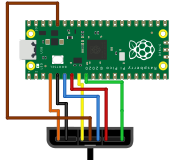

# PicoPS2PopN

Firmware for a **Raspberry Pi Pico** (RP2040) that turns a **KONAMI Pop'n Music PS2 controller** into a USB controller for the PC. It's written in C on the **Pico SDK** with **TinyUSB**.

- **Pop'n controller mode:** a plug-and-play USB HID controller with 9 buttons plus SELECT and START, shown as **PS2 Pop'n Controller**.
- Detects a Pop'n controller automatically and hides its always-held Left/Down/Right "ID" buttons.
- Also offers a **keyboard** mode, picked by holding SELECT while plugging in.
- Works with **other PS2 controllers** too (DualShock 2, PS1 pads), which appear as a standard USB gamepad.
- Has a button combo that puts the Pico into **BOOTSEL** for flashing, so you never have to press the Pico's own button.

---

## 1. Wiring

### Parts
- Raspberry Pi Pico (RP2040)
- KONAMI Pop'n Music PS2 controller, plus a PS2 extension cable or socket to wire into
- **10 kΩ resistor** (DATA pull-up, required; 4.7 kΩ – 10 kΩ works)

### Pop'n controller → Pico

The PS2 plug has 9 pins in three groups of three, numbered 1–9 from one end:

```
   _________________________________
  | 1   2   3 | 4   5   6 | 7   8   9 |
   \_______________________________/
```

The Pop'n controller cable **does not use the standard PS2 colours**: red and black are *not* power and ground. These colours were measured on a KONAMI Pop'n cable:



| PS2 pin | Signal | Pop'n wire | Pico GPIO | Pico pin |
|:-:|---|---|:-:|:-:|
| 1 | DATA | **orange** | **GP2** | 4 |
| 2 | COMMAND | **black** | **GP3** | 5 |
| 3 | Motor power | *(no wire)* | — | — |
| 4 | GND | **yellow** | **GND** | 38 |
| 5 | VCC 3.3 V | **brown** | **3V3 OUT** | 36 |
| 6 | ATTENTION | **blue** | **GP4** | 6 |
| 7 | CLOCK | **red** | **GP5** | 7 |
| 8 | not used | *(no wire)* | — | — |
| 9 | ACK | **green** | GP6 *(optional, unused)* | 9 |

Plus the **10 kΩ pull-up between GP2 (pin 4) and 3V3 OUT (pin 36)**.

```
                   Raspberry Pi Pico
                 ┌──────────────────┐
  orange (DATA) ─┤ GP2  (pin 4)     │
         │       │                  │
       [10k]     │                  │
         │       │                  │
  3V3 ───┴───────┤ 3V3 OUT (pin 36) ├── brown (VCC)
  black  (CMD)  ─┤ GP3  (pin 5)     │
  blue   (ATT)  ─┤ GP4  (pin 6)     │
  red    (CLK)  ─┤ GP5  (pin 7)     │
  yellow (GND)  ─┤ GND  (pin 38)    │
                 └──────────────────┘
```

> **WARNING Wire by pin number, not by colour.** Colours differ between cables; check yours with a multimeter (continuity) before powering up.
>
> **Never connect VCC or the pull-up to 5 V / VBUS (pin 40).** The controller and the Pico's GPIOs are 3.3 V.
>
> The DATA line is open-drain and **needs the 10 kΩ pull-up**. Without it the controller is not detected.

### Wiring inside the Pop'n controller

If you'd rather wire straight to the controller's board, the cable lands on a 7-pin header inside the controller. Viewed from behind the controller, the positions are:

| Header position | Wire | PS2 pin | Signal | Pico |
|:-:|---|:-:|---|---|
| 1 | brown | 5 | VCC 3.3 V | 3V3 OUT (pin 36) |
| 2 | blue | 6 | ATTENTION | GP4 (pin 6) |
| 3 | red | 7 | CLOCK | GP5 (pin 7) |
| 4 | black | 2 | COMMAND | GP3 (pin 5) |
| 5 | orange | 1 | DATA | GP2 (pin 4) + 10 kΩ to 3V3 |
| 6 | green | 9 | ACK | GP6 (pin 9), optional |
| 7 | yellow | 4 | GND | GND (pin 38) |

### Other PS2 controllers

Same pins and the same Pico connections. Most standard PS2 cables use these colours (verify yours):

| PS2 pin | 1 DATA | 2 CMD | 3 Motor | 4 GND | 5 VCC | 6 ATT | 7 CLK | 8 — | 9 ACK |
|---|---|---|---|---|---|---|---|---|---|
| Usual colour | brown | orange | grey | black | red | yellow | blue | white | green |

Leave pin 3 (motor power) unconnected; rumble is not supported.

---

## 2. Building

### Raspberry Pi Pico VS Code extension (recommended)

1. Install VS Code and the **Raspberry Pi Pico** extension (`raspberry-pi.raspberry-pi-pico`).
2. Open this folder. It's already set up for the extension (Pico SDK 2.3.1, toolchain 15.2), which downloads them on first use.
3. Click **Compile** in the status bar.
4. The firmware is written to **`build/PicoPS2.uf2`**.

### Terminal

With `PICO_SDK_PATH` set (SDK 1.5.1 or newer) and the ARM toolchain, CMake and Ninja on your `PATH`:

```sh
cmake -S . -B build -G Ninja
cmake --build build
```

---

## 3. Flashing

- **BOOTSEL button:** hold the Pico's BOOTSEL button while plugging it in, then copy `build/PicoPS2.uf2` onto the **RPI-RP2** drive.
- **From the controller:** once this firmware is installed, **hold SELECT + START while plugging in**. The Pico reboots into BOOTSEL.
- **VS Code:** with the Pico in BOOTSEL, click **Run** in the status bar.

---

## 4. Using it (Pop'n controller mode)

1. Plug the Pico in **without holding any button**. The Pico's LED turns solid when the controller is found.
2. The controller appears as a USB HID game controller called **PS2 Pop'n Controller**.
3. In your software's input settings, bind each Pop'n button by pressing it on the controller.

| Pop'n controller | HID button | (PS2 button) |
|---|---|---|
| Button 1 | Button 1 | Triangle |
| Button 2 | Button 2 | Circle |
| Button 3 | Button 3 | R1 |
| Button 4 | Button 4 | X |
| Button 5 | Button 5 | L1 |
| Button 6 | Button 6 | Square |
| Button 7 | Button 7 | R2 |
| Button 8 | Button 8 | Up |
| Button 9 | Button 9 | L2 |
| SELECT | Select | Select |
| START | Start | Start |

SELECT and START are reported as the standard HID *Select* and *Start* controls, so input settings usually show them under those names.

### Status LED

| LED | Meaning |
|---|---|
| Blinking | No controller detected (retries every second) |
| Solid | Controller connected |

---

## 5. Output modes

The mode is picked **once**, when the controller is first detected after power-up. Hold the button(s) **before and while plugging in**, then let go. The held button is ignored until released, so it doesn't trigger anything.

| Hold while plugging in | Mode |
|---|---|
| *(nothing)* | **Pop'n controller** (HID). Other PS2 pads get **Gamepad** instead |
| SELECT | **Keyboard** |
| SELECT + START | Reboot into **BOOTSEL** for flashing |

Replug to change mode.

### Keyboard mode (hold SELECT)

| Button | Key | Button | Key |
|---|:-:|---|:-:|
| Button 1 | I | Button 7 | T |
| Button 2 | O | Button 8 | W |
| Button 3 | G | Button 9 | R |
| Button 4 | K | SELECT | Space |
| Button 5 | F | START | X |
| Button 6 | L | | |

Any number of keys can be held at once.

---

## 6. Other PS2 controllers

Any PS2 controller that works like a standard pad is supported. Without anything held at plug-in, it appears as a **USB gamepad** (check it with Win + R → `joy.cpl`). Analog controllers are locked into analog mode; the left stick is X/Y and the right stick is Z/Rz.

| PS2 button | Gamepad | Keyboard |
|---|:-:|:-:|
| Select | 1 | Space |
| L3 / R3 | 2 / 3 | Q / E |
| Start | 4 | X |
| D-pad Up / Right / Down / Left | 5 / 6 / 7 / 8 | W / D / S / A |
| L2 / R2 / L1 / R1 | 9 / 10 / 11 / 12 | R / T / F / G |
| Triangle / Circle / X / Square | 13 / 14 / 15 / 16 | I / O / K / L |

Building with `-DPS2_DPAD_AS_HAT=ON` sends the D-pad as a hat switch instead of buttons 5–8.

---

## 7. Customising

| What | Where |
|---|---|
| Pins | `PIN_DATA`, `PIN_CMD`, `PIN_ATTN`, `PIN_CLK` in `src/main.c` |
| Pop'n button layout | `popn_button[]` in `src/main.c` |
| Keyboard keys | `keymap[]` in `src/main.c` (HID key codes up to 0x3F: letters, numbers, Enter, Esc, Space, ...) |
| Controller clock speed | `PS2_CLK_DELAY_US` in `src/ps2_controller.h` (10 µs; raise to 20–50 for long cables) |
| Poll rate | `PS2_READ_INTERVAL_MS` in `src/ps2_controller.h` (2 ms) |
| USB name | `strings[]` in `src/usb_descriptors.c` |
| USB VID/PID | `USB_VID` / `USB_PID` in `src/usb_descriptors.c` (a pid.codes **test** ID; use your own before distributing) |

---

## 8. Troubleshooting

| Problem | Check |
|---|---|
| LED keeps blinking | 10 kΩ pull-up between GP2 and 3V3 · wires are on the right **pin numbers** (not colours) · VCC (brown on Pop'n) and GND (yellow on Pop'n) connected |
| Buttons flicker or are wrong | Raise `PS2_CLK_DELAY_US` to 20–50 and rebuild |
| Wrong mode | The mode is fixed at power-up; replug while holding the right button (or nothing) |
| Software doesn't react | Restart it after plugging in (some programs only look for devices at start-up) · rebind the buttons if they were bound to an older firmware version |
| Windows shows an old name after a firmware update | Device Manager → View → *Show hidden devices* → uninstall old *PS2 Pop'n Controller* entries → replug |

---

## 9. Project layout

```
CMakeLists.txt            build script (Pico SDK / VS Code extension)
pico_sdk_import.cmake     locates the Pico SDK
src/main.c                modes, button mapping, USB reports, main loop
src/ps2_controller.c/.h   bit-banged PS2 controller driver
src/usb_descriptors.c/.h  USB device / HID descriptors and names
src/tusb_config.h         TinyUSB configuration
```
